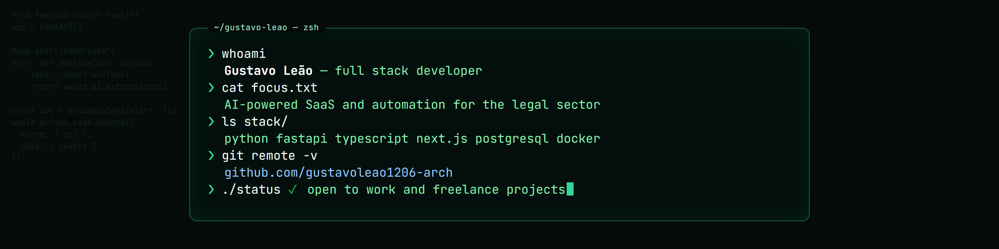
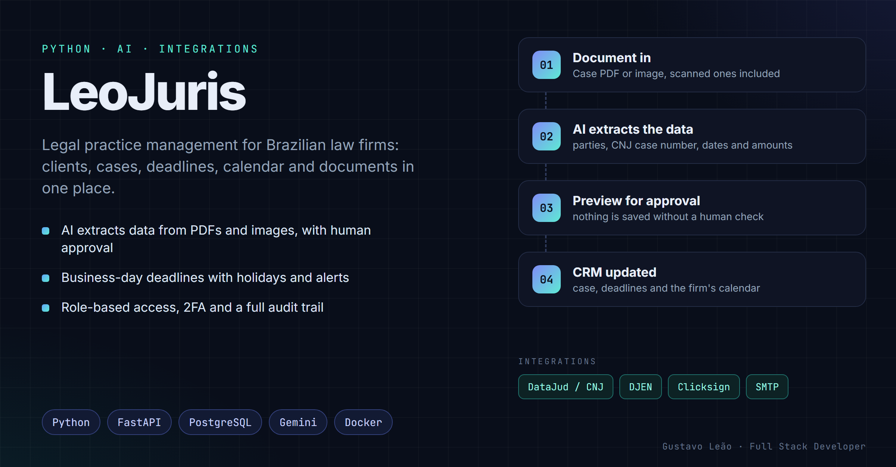
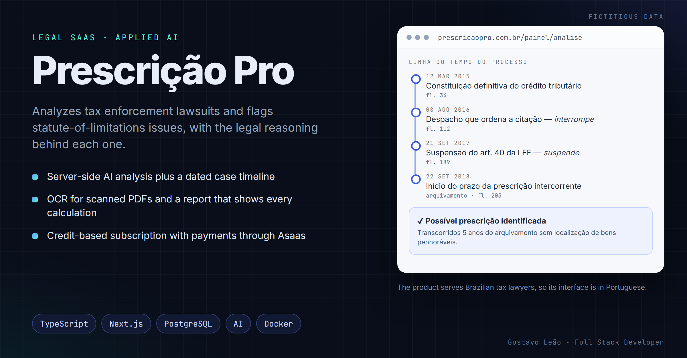
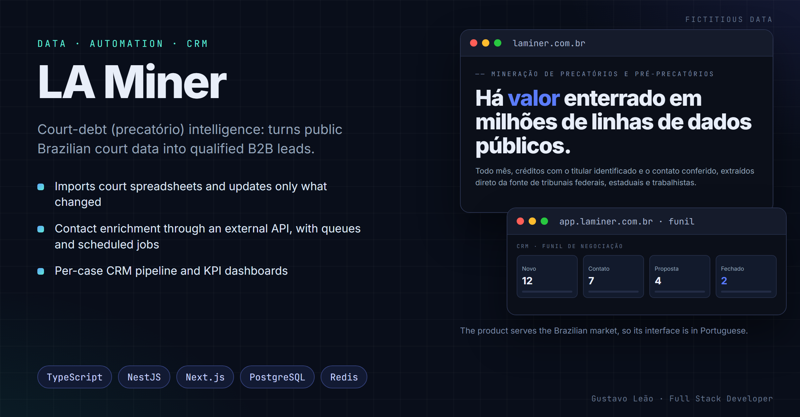

  

<h2 align="center">Gustavo Leão · Full Stack Developer</h2>

  AI-powered SaaS and automation for the legal sector

  
  
  

---

## About me

I build web systems and SaaS products for law firms and legal departments that need to get off spreadsheets, automate repetitive work and keep their data in one place. Most of what I ship runs in production for real users, so I care as much about security, tests and maintainability as about features.

- **Now:** building legal SaaS products at Leão Amorim Tecnologia, and developing and automating internal HR (TOTVS) and legal systems at TV Gazeta de Alagoas
- **Education:** currently studying at UNINTER
- **Open to work:** full-time roles and freelance projects

## Tech stack

  
  
  
  
  
  
  
  
  
  
  
  
  
  
  
  

## Featured projects

All of them are open source. The products serve Brazilian users, so their interfaces and code comments are in Portuguese; every repository has an English README.

### [LeoJuris](https://github.com/gustavoleao1206-arch/leojuris) · legal practice management

Clients, cases, business-day deadlines, calendar, documents and fee splitting for a law firm, with court-gazette monitoring (DJEN) and case-status updates from DataJud/CNJ. AI reads PDFs and images, a person approves, and the system updates everything. Running in production at a Brazilian law firm.

**Highlights:** two-layer role-based access control, TOTP 2FA, audit trail, CSP without `unsafe-inline`, rate limiting, installable PWA, 967 automated tests.

**Stack:** Python · FastAPI · SQLAlchemy · PostgreSQL · vanilla JS

### [Prescrição Pro](https://github.com/gustavoleao1206-arch/prescricao-pro-saas) · legal SaaS with applied AI

Analyzes tax enforcement lawsuits from the case PDF and flags statute-of-limitations issues, with deterministic date checks, an AI-written report showing every calculation, and a draft petition. Credit-based subscription with payments through Asaas.

**Highlights:** idempotent credit ledger with refunds, field-level AES-256-GCM encryption, data-retention jobs, nonce-based CSP, 985 automated tests.

**Stack:** TypeScript · Next.js · Prisma · PostgreSQL · Docker · [live product](https://prescricaopro.com.br)

### [LA Miner](https://github.com/gustavoleao1206-arch/la-miner) · court-data intelligence

B2B prospecting SaaS that turns public Brazilian court data into qualified leads: incremental spreadsheet imports from the federal courts, contact enrichment through an external API with queues and scheduled jobs, a per-case CRM and KPI dashboards.

**Highlights:** multi-tenant API, refresh-token rotation with reuse detection, BullMQ workers, a CI gate that blocks deploys on vulnerable dependencies, 1,166 automated tests.

**Stack:** TypeScript · NestJS · Next.js · Prisma · PostgreSQL · Redis/BullMQ · [live product](https://laminer.com.br)

### [Kadosh Ops Platform](https://github.com/gustavoleao1206-arch/kadosh-ops-platform) · operations for a car-detailing business

One API, one database and one login serving a web back office and an Android app: clients and vehicles, service catalog with negotiated prices, scheduling and work orders, vehicle intake in a single transaction, and payments that can be reversed but never edited.

**Highlights:** login throttling by IP, by origin and by account, so a stranger cannot lock the owner out; 534 backend tests at 98% coverage, plus web and mobile suites.

**Stack:** Python · FastAPI · PostgreSQL · React · Flutter

### [Aethelgard](https://github.com/gustavoleao1206-arch/aethelgard) · Unity multiplayer game (source code)

A co-op action RPG for 1–4 players built with Unity 6 and Netcode for GameObjects, with a server-authoritative game loop: every gameplay request is validated on the server against the sender's own connection. The repository holds the code only; the licensed art is not included.

**Stack:** C# · Unity 6 · Netcode for GameObjects · URP

Screens show fictitious data.

## What I deliver

- Custom systems: web dashboard, role-based login, records and finance
- Applied AI: document reading, data extraction and assistants over your own data
- Automation: scheduled jobs, spreadsheet imports and document generation
- API integrations: payments, e-signature, courts and email
- Automated tests, deployment and user documentation

## Contact

Reach me on [LinkedIn](https://www.linkedin.com/in/gustavo-leao-dev) or [Workana](https://www.workana.com/freelancer/e374923f8c4b54cab1f5f7d6e4b1725b).
