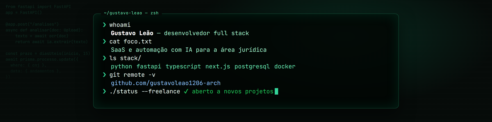
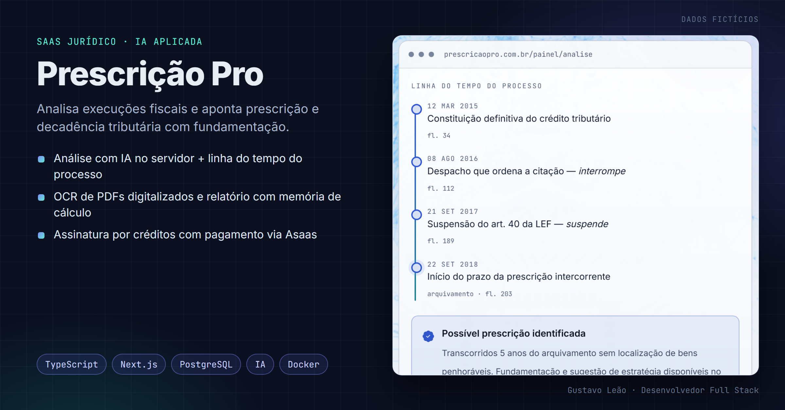
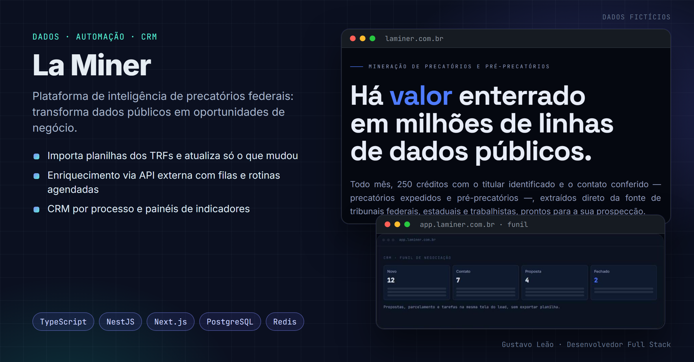
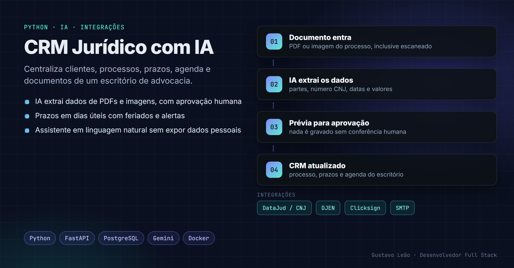

  

<h2 align="center">Gustavo Leão · Desenvolvedor Full Stack</h2>

  SaaS e automação com IA para a área jurídica

  
  
  

---

## Sobre mim

Desenvolvo sistemas web e SaaS com inteligência artificial para escritórios e departamentos jurídicos que precisam sair das planilhas, automatizar tarefas repetitivas e ter os dados num só lugar.

- **Hoje:** Leão Amorim Tecnologia, criando produtos SaaS jurídicos, e TV Gazeta de Alagoas, desenvolvendo e automatizando sistemas internos de RH (TOTVS) e Jurídico
- **Formação:** cursando na UNINTER
- **Disponível** para projetos freelance, por etapas e com escopo fechado

> **EN:** Full stack developer building AI-powered SaaS and automation for the legal sector. Python · TypeScript · Next.js · FastAPI · PostgreSQL. Open to freelance projects.

## Stack

  
  
  
  
  
  
  
  
  
  
  
  
  

## Projetos em destaque

### Prescrição Pro · SaaS jurídico com IA

Analisa execuções fiscais e aponta prescrição e decadência tributária com fundamentação: IA no servidor, OCR de PDFs digitalizados, relatório com memória de cálculo e assinatura por créditos via Asaas.
**Stack:** TypeScript · Next.js · PostgreSQL (Prisma) · Docker · [ver o produto](https://leaoamorimtecnologia.com.br/prescricao-pro)

### La Miner · inteligência de precatórios federais

Transforma dados públicos dos tribunais em oportunidades de negócio: importação de planilhas dos TRFs com reimportação incremental, enriquecimento via API externa com filas e rotinas agendadas, CRM por processo e painéis de indicadores.
**Stack:** TypeScript · NestJS · Next.js · PostgreSQL (Prisma) · Redis/BullMQ · [ver o produto](https://laminer.com.br)

### CRM Jurídico com IA · Python/FastAPI

Centraliza clientes, processos, prazos, agenda e documentos de um escritório de advocacia. A IA extrai dados de PDFs e imagens, o usuário aprova e o sistema atualiza tudo. Integrações com DataJud/CNJ, DJEN e Clicksign.
**Stack:** Python · FastAPI · SQLAlchemy · PostgreSQL · Docker

As telas mostradas usam dados fictícios.

## O que eu entrego

- Sistema sob medida: painel web, login por perfil, cadastros e financeiro
- IA aplicada: leitura de documentos, extração de dados e assistentes sobre seus dados
- Automação: rotinas agendadas, importação de planilhas e geração de documentos
- Integrações com APIs: pagamento, assinatura digital, tribunais e e-mail
- Testes automatizados, publicação online e documentação de uso

## Contato

Fale comigo pelo [LinkedIn](https://www.linkedin.com/in/gustavo-leao-dev) ou pelo [Workana](https://www.workana.com/freelancer/e374923f8c4b54cab1f5f7d6e4b1725b).
